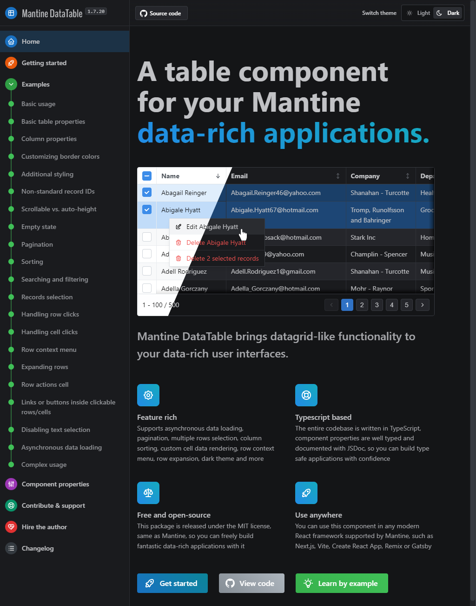
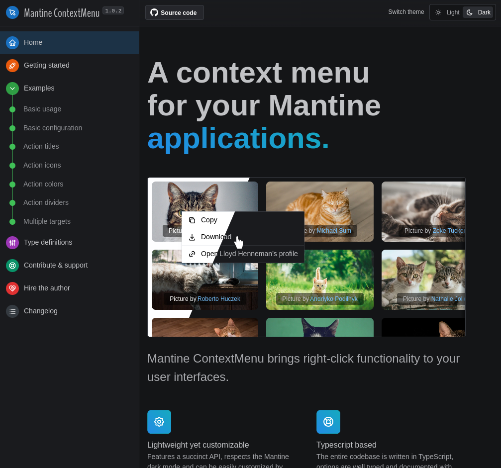
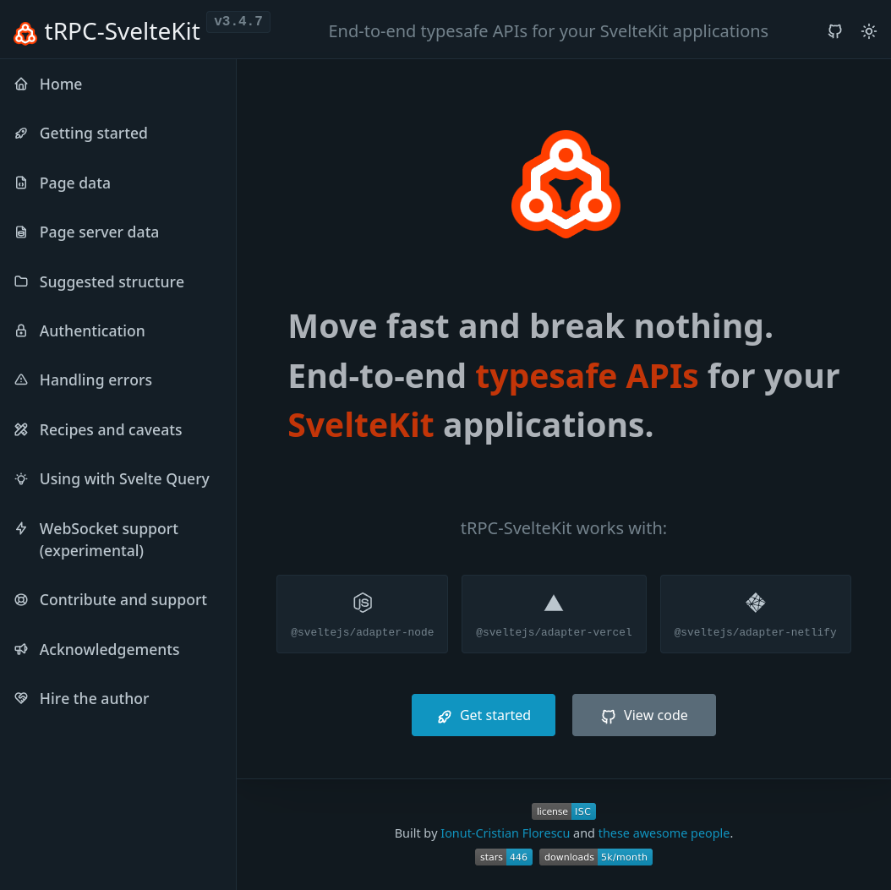
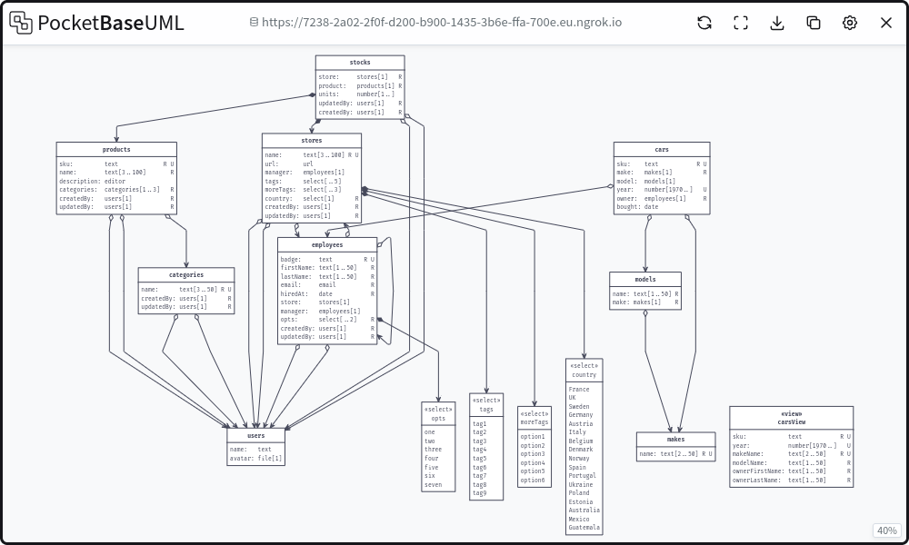
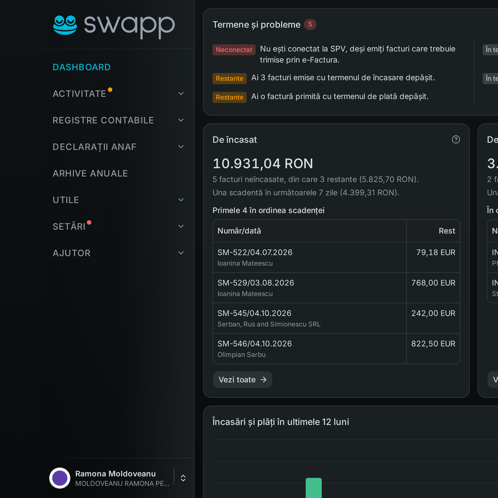

## In a nutshell

A hands-on fractional CTO, product builder and open-source author from Bucharest, Romania, EU, building for the web since 1998 (👉 [download résumé](https://raw.githubusercontent.com/icflorescu/icflorescu/main/ionut-cristian-florescu--resume.pdf)).  
I take software products from a blank repo to production, and stay to run them for a decade. I still write production code; I've also learned which code isn't worth writing.  
Curious by nature, an avid reader of fantasy, fiction, history & tech-related literature, always looking to understand how things work and to make them work better.  

Creator of 📒 [Mantine DataTable](https://icflorescu.github.io/mantine-datatable/) (~400k npm downloads a month), 🖱️ [Mantine ContextMenu](https://icflorescu.github.io/mantine-contextmenu/), ✨ [tRPC-SvelteKit](https://icflorescu.github.io/trpc-sveltekit) and 📦 [PocketBaseUML](https://pocketbase-uml.github.io).  
Also built ✨ [Next.js Parallel Server Actions](https://github.com/icflorescu/next-server-actions-parallel), 🐧 [Expose-WSL](https://github.com/icflorescu/expose-wsl), 🌐 [IISExpress-Proxy](https://github.com/icflorescu/iisexpress-proxy) and [other open-source projects](#notable-open-source-projects-ive-built-over-the-years).  
On the commercial side: 🐸 [swapp.ro](https://swapp.ro/), my own SaaS, and 🚗 [LeasingSH.ro](https://www.leasingsh.ro/), where I've been the technical partner since 2013.

  
  
  
  
  

Open to fractional CTO and technical partner roles for early-stage products, and to sweat-equity partnerships where I own the technical side.  
Fractional CTO and sweat-equity partner at [LeasingSH.ro](https://www.leasingsh.ro/).  
Owner / Jack of all trades @ 🐸 [swapp.ro](https://swapp.ro/)[^1].  
Ex [Allianz](https://www.allianz.com/en.html), [National Bank of Greece](https://www.nbg.gr/en) and [AJM FleetPurchase](https://ajm-fleetpurchase.com/).  
Co-owner of [Yadda](https://yadda.ro).  
~~Doing stuff at [SegmentX.ai/SalesPlay](https://salesplayx.com/).~~  

## OSS activity

  

## Current tech-stack

- **TypeScript/JavaScript**
- **Node.js and [Bun](https://bun.sh/)**
- **[TanStack](https://tanstack.com/) Start, Router, Query & Form, React, Next.js, Remix/React Router**, but I'm also **interested in Svelte/SvelteKit**
- **React UI Frameworks** I've been working with:
  - **[Mantine](https://mantine.dev) — I'm a contributor and also the author of 📒 [Mantine DataTable](https://icflorescu.github.io/mantine-datatable/) and 🖱️ [Mantine ContextMenu](https://icflorescu.github.io/mantine-contextmenu/)**
  - **[shadcn/ui](https://ui.shadcn.com/) over [Base UI](https://base-ui.com/)**, which is what [swapp.ro](https://swapp.ro) is built with
  - **[Ant Design](https://ant.design/components/overview/)**
  - **[MaterialUI](https://mui.com/)**
  - **[Blueprint.js](https://blueprintjs.com/)**
- **[tRPC](https://trpc.io) — I'm a contributor and the creator of ✨ [tRPC-SvelteKit](https://icflorescu.github.io/trpc-sveltekit)** and ✨ **[tRPC-Transformer](https://github.com/icflorescu/trpc-transformer)**
- **PostgreSQL, [DrizzleORM](https://orm.drizzle.team/)**, [Prisma](https://www.prisma.io/)/[ZenStack](https://zenstack.dev/), [Knex.js](https://knexjs.org/), [Kysely](https://kysely.dev/), [Hasura](https://hasura.io/)
- SQL in general; I have designed enterprise SQL Server/Oracle DB architectures while working for multinational companies in the past
- [Valtio](https://valtio.dev/docs/introduction/getting-started), [Zustand](https://zustand.docs.pmnd.rs/getting-started/introduction) & [Jotai](https://jotai.org/) — I favor modern state-management solutions over plain Redux
- Worked with **[NextAuth/Auth.js](https://authjs.dev/)** and **Firebase** (mostly firebase-auth), but these days I'm just as happy rolling my own sessions
- [PocketBase](https://pocketbase.io/) — I'm a fan of the lightest "back-end in one file" solution and **the creator of 📦 [PocketBaseUML](https://pocketbase-uml.github.io/)**
- **Docker & [Caddy](https://caddyserver.com/)** on a plain VPS — I self-host what I build, with no cloud bill to dread
- I have a few CSS tricks up my sleeve, a good understanding of the DOM, I'm fluent with CSS-in-JS, SASS/CSS-Modules, PostCSS, Emotion and I'm even good-enough at creating website/application designs *from scratch*; here are some examples:
  - The docs websites for [Mantine DataTable](https://icflorescu.github.io/mantine-datatable/), [Mantine ContextMenu](https://icflorescu.github.io/mantine-contextmenu/), [tRPC-SvelteKit](https://icflorescu.github.io/trpc-sveltekit/) and [ASPAX](https://aspax.github.io)
  - [swapp.ro](https://swapp.ro), [yadda.ro](https://yadda.ro), [boutiquetravel.ro](https://boutiquetravel.ro/), [interiordelight™️](https://interiordelight.github.io/), [King's Host](https://kingshost.github.io/), [AJM Fleet Purchase](https://ajm-fleetpurchase.com/), [sellcarbuycar.com](https://sellcarbuycar.com/), [LeasingSH.ro](https://www.leasingsh.ro/), [PocketBaseUML](https://pocketbase-uml.github.io/)

These days I'm happily using Tailwind too: [swapp.ro](https://swapp.ro) is Tailwind CSS 4 and shadcn/ui all the way down.

## Things I've worked with in the Dark Ages

- PHP & MySQL, around Y2K (yeah, I've been around a while)
- Java/J2EE, .NET/C#, Oracle, SQL Server, BizTalk, cca. 2002—2007
- CoffeeScript & IcedCoffeeScript, back when JS had no async/await
- Quite a few templating languages such as [Mustache](https://github.com/janl/mustache.js) or [Jade/Pug](https://pugjs.org/api/getting-started.html) and some strange old JS frameworks ([Backbone](https://backbonejs.org/), [Riot.js](https://riot.js.org/)) in the pre-React era

## Notable open-source projects I've built over the years

- 📒 [Mantine DataTable](https://icflorescu.github.io/mantine-datatable/) — a "dark-theme aware" table component for your Mantine UI data-rich applications, featuring asynchronous data loading support, pagination, multiple rows selection, column sorting, custom cell data rendering, row context menu, and more
- 🖱️ [Mantine ContextMenu](https://icflorescu.github.io/mantine-contextmenu/) — a lightweight yet customizable context-menu for your Mantine applications, with a succinct API and dark-theme support
- 🛠️ [Mantine Start](https://github.com/icflorescu/mantine-start) and [Mantine Next](https://github.com/icflorescu/mantine-next) — starter templates for Mantine and TanStack Start / Next.js applications
- ✨ [tRPC-SvelteKit](https://icflorescu.github.io/trpc-sveltekit) — an adapter allowing you to build end-to-end typesafe APIs with tRPC.io in your SvelteKit applications
- ✨ [tRPC-Transformer](https://github.com/icflorescu/trpc-transformer) — a simple tRPC transformer based on superjson with Decimal.js support
- ✨ [Next.js Parallel Server Actions](https://github.com/icflorescu/next-server-actions-parallel) — run Next.js server actions in parallel: the missing ingredient for a boilerplate-free, tRPC-style server-actions workflow
- 📦 [PocketBaseUML](https://pocketbase-uml.github.io/) — a free, open-source UML diagram generator for PocketBase that can be used online to connect to HTTPS servers, or run as an `npm` package to inspect local HTTP servers
- 🐧 [Expose-WSL](https://github.com/icflorescu/expose-wsl) — probably the easiest way to expose apps running on WSL to local network devices
- 🌐 [IISExpress-Proxy](https://github.com/icflorescu/iisexpress-proxy) — a simple, yet practical command-line utility enabling .NET developers to test web applications served by IIS Express on remote devices; it's been around since 2015, but *I'm amazed by the sheer number of people who still have to use **IISExpress** nowadays*
- 📖 [textdiff-create](https://github.com/icflorescu/textdiff-create) and [textdiff-patch](https://github.com/icflorescu/textdiff-patch) — simple utilities for [creating and applying lean text diffs](https://medium.com/@icflorescu/lean-diffs-for-browser-based-text-editors-46e363bc6dfe)
- 🛠️ [ASPAX](https://aspax.github.io/) — a simple **Node.js asset packager** inspired by Rails, in 2013, when Webpack didn't exist
- ⚙️ [Node.js](https://github.com/icflorescu/openshift-cartridge-nodejs), [MongoDB](https://github.com/icflorescu/openshift-cartridge-mongodb), [PostgreSQL](https://github.com/icflorescu/openshift-cartridge-postgresql) & [MySQL](https://github.com/icflorescu/openshift-cartridge-mysql) cartridges for **Red Hat's OpenShift**, in 2014-2015, when Docker wasn't yet a widespread tool

> [!IMPORTANT]
> Please consider [sponsoring my work](https://github.com/sponsors/icflorescu) if you find it useful.  
> Dedicating time to build and maintain great open-source projects would not be possible without your generosity.  

## The long(er) story

You can find my boring, full-length ~~obituary~~ LinkedIn profile at [linkedin.com/in/icflorescu](https://www.linkedin.com/in/icflorescu/), but here's the blurb:
- 25+ years of experience in web and software development
- I've worked for various companies (from mid-sized to large multinationals such as [Allianz](https://www.allianztiriac.ro/) and Garanta — [member of National Bank of Greece](https://www.nbg.gr/en/group)) during the initial part of my career; since 2008 I've been working independently
- Technical partner at [LeasingSH.ro](https://www.leasingsh.ro/) since 2013, rebuilt three times as the web evolved, keeping the business running through each migration
- In 2026 I rebuilt 🐸 [swapp.ro](https://swapp.ro/) from scratch, solo, in five months: invoicing and single-entry accounting for Romanian freelancers, wired into the national e-invoicing system
- I'm at home in rule-heavy domains (insurance, leasing, tax), where "almost right" means wrong
- I sometimes ~~rant~~ write about technology and its impact on human behaviour in [articles like these](https://www.linkedin.com/in/icflorescu/recent-activity/posts/)

## Hobbies, likes & dislikes

❤️ open-source, lazy mornings, good coffee, trekking in the mountains, reading  
👎 hypocrisy, xenophobia, willful ignorance, people talking bullshit  

## Before approaching me for work

I'm interested in fractional CTO and technical partner roles for early-stage products, sweat-equity partnerships where I own the technical side, and selected hands-on work.  

You can learn more about what I did over the years by visiting my [LinkedIn profile](https://www.linkedin.com/in/icflorescu/), but since you are on this page, chances are that you already have a pretty good idea of how my skills could be of assistance.  
If you want to hire me, please consider that I'm most productive with [the aforementioned tech-stack](#current-tech-stack).  

> [!NOTE]
> I'm currently getting a constant flow of approaches, some of them relevant, others not so relevant[^2]. Therefore, mentioning in your text that *you've seen my GitHub profile* would:
> - tell me that you know exactly what you need me for (as opposed to just trying to fill a vacant role);
> - let me know that my skills would indeed be valuable for you and would spare us both valuable time that we'd otherwise have to spend in trying to assess that;
> - help me **prioritize your message** and come up with a quick reply.

## How to approach me

Drop me a message at the email address listed in my GitHub profile and we'll schedule a meeting on [cal.com/icflorescu](https://cal.com/icflorescu).

[^1]: For a while I couldn't find the time and motivation to turn [swapp.ro](https://swapp.ro/) into a real business, and the Romanian Government's digital strategy around e-Factura was (still is) a major clusterduck. So in 2026 I rebuilt it from scratch, e-Factura and all, and opened it up again: free while it's being finished.

[^2]: I'm not really a fan of multistage recruitment processes and taking coding tests.  
      My open-source projects are being starred and used by lots of developers and companies worldwide, sum up millions of NPM downloads and my coding skills are, therefore, vetted by the community.  
      If you want my help, we will be discussing about project specifics such as its value proposition and how can I contribute to "make it happen", challenges and how to overcome those, risks versus rewards.
